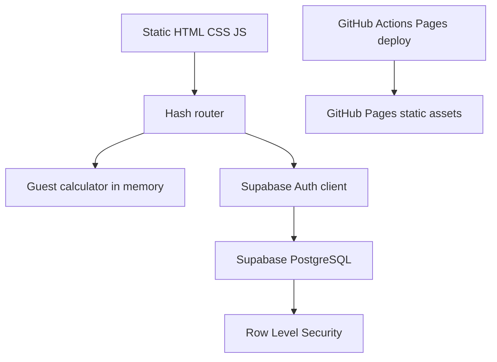
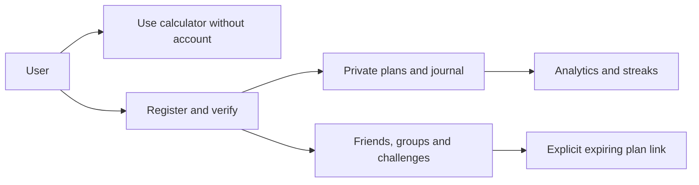
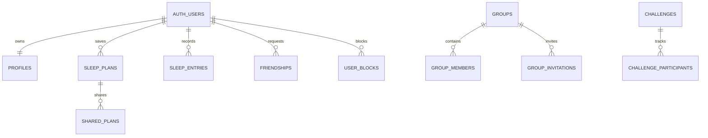

# SleepWise

SleepWise is a privacy-first, bilingual sleep calculator and wellness journal built with **HTML5, CSS3, vanilla JavaScript ES modules, Supabase, and GitHub Pages**. It is served directly as static files: there is no frontend framework, build step, server, service-role key, reminder system, or notification system.

## Features

- Free guest questionnaire, bedtime/wake-up calculator, age-range guidance, illustrative timeline, and deterministic routine tips. Guest answers are held in JavaScript memory only and disappear on refresh.
- English and Czech interface controls, browser-language default, dark and light themes, responsive layouts, keyboard-friendly native form controls, reduced-motion support.
- Supabase email/password registration, verification, login/logout, password reset, saved plans, weekly schedules, self-reported journal, analytics and consistency streaks.
- Friend requests, block controls, private groups/invitations, challenge participation, explicitly created expiring/revocable sleep-plan links, profile privacy, and user data export.
- PostgreSQL migrations with RLS policies. Private sleep records are owner-only; challenges and groups use database-authorized functions and policies.

Social interfaces and database schemas are included; actual use of authenticated/cloud functionality requires a configured Supabase project and applying the migrations. Do not claim a configured production backend until those steps are done.

## Run locally

Serve the repository root using any static HTTP server. ES modules require HTTP(S), not `file://`.

```sh
python3 -m http.server 4173
```

Open <http://localhost:4173>. Optional syntax and calculation tests run using Node's built-in test runner:

```sh
node --test tests/*.test.js
```

There is no npm install, compile step, or running Node server requirement. A static file server is only needed to view the app locally.

## Supabase setup

1. Create a Supabase project.
2. Run `supabase/migrations/202610230001_initial.sql` and then `202610230002_account_and_social_hardening.sql` in the Supabase SQL editor or with Supabase CLI migration tooling.
3. Configure Auth > URL Configuration. Set the Site URL to `https://USERNAME.github.io/REPOSITORY/` and allow that URL plus `https://USERNAME.github.io/REPOSITORY/#/login` as appropriate redirects. For local testing allow `http://localhost:4173/`.
4. In repository Settings > Secrets and variables > Actions > Variables, add `SUPABASE_URL` and `SUPABASE_PUBLISHABLE_KEY` (the public anon/publishable client key).
5. The deploy workflow writes only those public values into a generated `js/config.js`. Never add `service_role`, database passwords, or other privileged secrets to Actions variables, static files, or browser code.

If the public settings are absent, the guest calculator still works; account pages explain that Supabase is not configured.

## GitHub Pages deployment

The workflow `.github/workflows/deploy.yml` publishes root static assets to GitHub Pages on pushes to `main` and manual workflow runs. In repository Settings > Pages, set the source to **GitHub Actions**. The application uses hash-based routing (`#/plans`, `#/analytics`, etc.) so refreshes and direct navigation work on a project page at `https://USERNAME.github.io/REPOSITORY/`. Repository name and username are supplied by GitHub Pages; no account/repository URL is hardcoded.

The deployment creates a static artifact directly; no Vite or build system is required.

## Database and privacy

The SQL schema includes profiles, sleep plans/entries, friendships, blocks, groups/memberships/invitations, challenges/participants, and shared plans. RLS is the authorization boundary. The browser uses the public key and never uses service-role credentials. Share links store SHA-256 token hashes in the database and expire/revoke through database state.

RLS and SQL functions should be reviewed in a staging Supabase project before real user data is collected. This project has not been independently security-audited or legally assessed. Review GDPR and other privacy requirements with qualified counsel; no legal-compliance claim is made. Account deletion requires successful user authentication and the database deletion RPC. Users should export data before deletion.

## Sleep information

Sleep duration ranges are general educational recommendations, not individual prescriptions. Age alone cannot determine an exact bedtime. Needs vary. SleepWise does not diagnose, treat, or measure sleep; journal records are user-reported. Seek professional advice for persistent sleep concerns.

## Architecture






